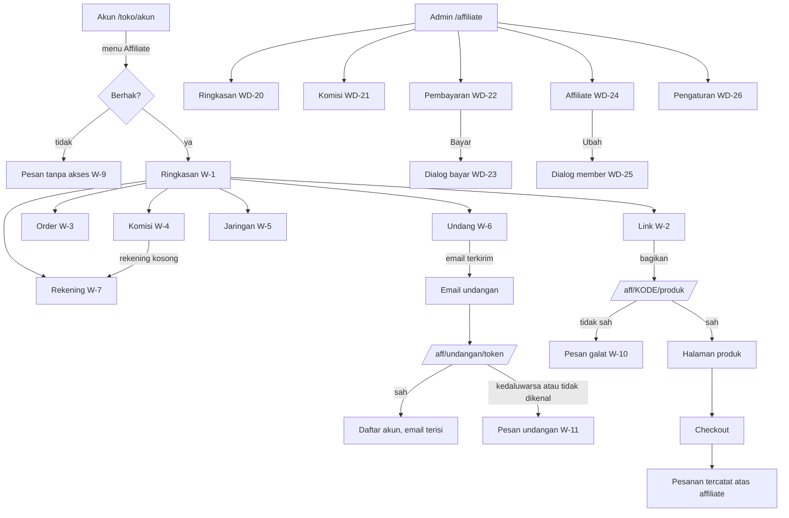

# 04 Wireframe: Program Affiliate

Produk: Toko online GNNK Racing · Versi 0.1 · 11 Okt 2026 · Status: draft · Terkait: [02 PRD](02-prd.md), [05 Design system](05-design-system.md)

## Prototipe

Aplikasi ini sudah punya komponen dan gaya sendiri, jadi wireframe dibuat sebagai rute kerangka di aplikasinya, bukan berkas HTML terpisah. Setiap keadaan layar punya alamat sendiri lewat parameter `?fixture=` yang hanya aktif di mode pengembangan (produksi tidak memuat data contohnya).

| Fixture | Isi |
|---|---|
| `ringkasan` | Affiliate dengan data lengkap, upline, 4 order, 6 komisi semua status, jaringan 2 tingkat, 4 undangan semua status |
| `kosong` | Affiliate baru tanpa data dan tanpa rekening |
| `kontak` | Seperti `ringkasan`, dengan kontak pembeli dan downline diizinkan |
| `tanpa-akses`, `program-mati` | Member tanpa akses dan program mati |
| `galat-kode`, `galat-produk`, `galat-mati`, `galat-izin`, `undangan-hilang`, `undangan-kedaluwarsa`, `memuat` | Halaman pembuka link dan undangan |
| `isi`, `kosong` (admin) | Layar admin berisi dan kosong |

Perintah render (dev server di `127.0.0.1:5173`, sesi admin dari skrip login uji):

```bash
node ~/.claude/skills/wireframing-screens/scripts/render-screens.mjs "http://127.0.0.1:5173/toko/affiliate?fixture=ringkasan&tab=link" --out docs/design/screens --viewports phone,small,desktop
node ~/.claude/skills/wireframing-screens/scripts/render-screens.mjs "http://127.0.0.1:5173/affiliate?fixture=isi&tab=pembayaran" --out docs/design/screens --viewports phone,small,desktop --storage sesi_admin.json
```

Gambar hasil render ada di `docs/design/screens/`.

## Alur layar



## Indeks layar

| ID HP | ID desktop | Layar | Rute dan keadaan | AC |
|---|---|---|---|---|
| W-1 | WD-1 | Ringkasan affiliate | `/toko/affiliate?tab=ringkasan`: berisi, kosong | AC-47, AC-48 |
| W-2 | WD-2 | Link | `tab=link`: kode, link toko, pencarian produk, parameter | AC-10 sampai AC-12 |
| W-3 | WD-3 | Order | `tab=order`: berisi, kosong, dengan kontak | AC-49 |
| W-4 | WD-4 | Komisi | `tab=komisi`: 4 status, rekening kosong, kosong | AC-34 |
| W-5 | WD-5 | Jaringan | `tab=jaringan`: 2 tingkat, nama terpanjang, dengan kontak, kosong | AC-39, AC-40 |
| W-6 | WD-6 | Undang | `tab=undang`: 5 status, email panjang, galat validasi, kosong | AC-42 sampai AC-44 |
| W-7 | WD-7 | Rekening | `tab=rekening` | FR-28 |
| W-8 | WD-8 | Memuat dan gagal memuat | kerangka abu-abu, tombol Coba lagi | AL-1 |
| W-9 | WD-9 | Tanpa akses | `tanpa-akses`, `program-mati` | AC-3, AC-4, AC-5 |
| W-10 | WD-10 | Pembuka link | memuat, 4 pesan galat Sejoli | AC-13 sampai AC-15 |
| W-11 | WD-11 | Pembuka undangan | kedaluwarsa, tidak dikenal | AC-46 |
| W-20 | WD-20 | Admin Ringkasan | berisi, kosong | AC-50 |
| W-21 | WD-21 | Admin Komisi | filter, aksi massal, kartu di HP | AC-35, AC-38 |
| W-22 | WD-22 | Admin Pembayaran | per affiliate, riwayat, kartu di HP | AC-36 |
| W-23 | WD-23 | Dialog bayar | rekening terisi dan kosong, bukti transfer | AC-36, AC-37 |
| W-24 | WD-24 | Admin Affiliate | daftar member, kartu di HP | FR-47 |
| W-25 | WD-25 | Dialog member | akses, kode, upline, jaringan | AC-41 |
| W-26 | WD-26 | Admin Pengaturan | semua bagian, galat validasi | AC-8 |

**Belum digambar sebagai kerangka, dibangun langsung di tahap pengembangan dan diperiksa di rencana uji:** tombol "Bagikan & dapat komisi" di halaman produk (FR-14), bagian Affiliasi di formulir produk (FR-10), menu Affiliate di halaman akun, halaman daftar dengan email undangan terisi, dan info affiliate di detail pesanan admin (FR-20).

## Keputusan tata letak

| Kode | Keputusan | Alasan |
|---|---|---|
| WF-1 | Dashboard affiliate memakai susunan halaman akun yang sudah ada: menu kiri di desktop, identitas dan menu geser di HP | Member sudah mengenal halaman akun. Tujuh menu tidak muat sebagai kolom tetap di 390 px, jadi menu HP digeser |
| WF-2 | Ringkasan memakai satu set lima ubin dengan pilihan Hari ini, Bulan ini, Sepanjang waktu | Sejoli menampilkan tiga blok berisi empat angka. Di HP itu dua belas ubin. Pilihan periode memendekkan halaman tanpa membuang angka |
| WF-3 | Omset dan Komisi mendapat kolom 1,5 kali di desktop, Komisi selebar layar dan berwarna di HP | Nilai rupiah terpotong di lima kolom sama lebar. Komisi adalah angka yang paling dicari affiliate |
| WF-4 | Halaman Link berurutan: kode, link toko, link produk, parameter | Dari yang paling sering dipakai ke yang paling jarang |
| WF-5 | Tiap link punya Salin, WhatsApp, dan Bagikan (hanya bila HP mendukung) | Pembagian paling sering lewat WhatsApp. Tombol bagikan bawaan HP disembunyikan bila tidak tersedia |
| WF-6 | Daftar admin berubah menjadi kartu di bawah 768 px | Di tabel yang digeser, tombol Bayar dan Ubah berada di luar layar |
| WF-7 | Dialog bayar menaruh total komisi dan rekening di atas, tombol konfirmasi bertuliskan "Tandai TELAH DIBAYAR" | Admin memeriksa jumlah dan rekening sebelum mentransfer. Teks tombol mengikuti teks Sejoli |
| WF-8 | Pengaturan memakai tombol simpan yang menempel di bawah layar | Halamannya panjang. Admin tidak perlu menggulir ke bawah untuk menyimpan |
| WF-9 | Pesan galat link memakai teks Sejoli persis, satu tombol "Ke toko" | Pengunjung tetap bisa belanja walau link rusak |
| WF-10 | Daftar admin (Kinerja per affiliate, Komisi, Pembayaran, Affiliate) berupa kartu di bawah 1.280 px, tabel mulai 1.280 px. Menggantikan WF-6 | Terukur di aplikasi jadi: wadah isi admin 726 px pada layar 768 px dan 718 px pada layar 1.024 px (bilah sisi melebar), sedangkan tabelnya 760 sampai 900 px, sehingga kolom Aksi keluar layar. Di 1.280 px wadahnya 974 px dan tabel muat |
| WF-11 | Tampilan kartu Komisi punya kotak "Pilih semua" di baris aksi massal | Kartu tidak punya kepala tabel tempat kotak itu biasanya berada |
| WF-12 | Di HP, tab aktif menu affiliate digeser ke tengah bilah menu | Tujuh tab tidak muat di 393 px. Saat halaman dibuka langsung di tab Undang atau Rekening, tab aktifnya berada di luar layar |
| WF-13 | Pilihan periode ringkasan berlabel "Hari ini", "Bulan ini", "Semua" | "Sepanjang waktu" terlipat dua baris di HP karena tiga pilihan berbagi satu baris |
| WF-14 | Keterangan di ubin angka boleh dua baris, tidak dipotong | Keterangan itu definisi angkanya (misalnya "Tanpa pesanan batal"). Terpotong, artinya hilang |
| WF-15 | Halaman pembuka link menampilkan layar galat hanya untuk link yang memang salah (kode, produk, izin, undangan). Jaringan putus, galat server, dan batas laju meneruskan pengunjung ke produk, toko, atau formulir daftar tanpa layar galat | Halaman itu ada untuk mengantar pengunjung ke produk. Layar galat karena gangguan sementara menghilangkan penjualan (D-29) |
| WF-16 | Kartu target bonus di Ringkasan affiliate, tepat di bawah ubin angka, dengan bilah kemajuan dan kalimat sisa target | Target bulanan adalah angka yang dikejar affiliate tiap hari; letaknya di layar pertama tab yang paling sering dibuka |
| WF-17 | Bonus dan potongan di tab Komisi: ubin hanya muncul bila nilainya ada, daftarnya di bawah daftar komisi | Sebagian besar affiliate tidak pernah punya potongan; ubin Rp 0 hanya menambah gulir di HP |
| WF-18 | Rincian bonus, potongan, dan yang ditransfer di admin Pembayaran ditulis sebagai baris kecil di bawah angka Belum dibayar, bukan kolom baru | Tabel 1.280 px sudah memenuhi wadahnya; kolom baru membuatnya terpotong |
| WF-19 | Tarif affiliate dipilih dengan tombol Ikut bawaan, 5%, 10%, 15%, Manual; Manual membuka jenis dan besar tarif | Tiga tarif yang disebut klien sekali sentuh, tarif lain tetap bisa (AS-3) |
| WF-20 | Undang affiliate adalah tombol di bilah cari tab Affiliate; daftar undangan admin di bawah daftar member | Mengundang dan mengubah akses member adalah pekerjaan yang sama: membuka akses affiliate |

## Pertanyaan

| Kode | Pertanyaan | Yang digambar |
|---|---|---|
| Q-10 | Perlu halaman leaderboard untuk memotivasi affiliate? | Tidak digambar, di luar cakupan leader |
| Q-11 | Teks email boleh memakai sapaan "Alhamdulillah" seperti Sejoli? | Teks Sejoli dipakai apa adanya |

## Cara pemeriksaannya

- Render 11 Okt 2026, Chrome lokal, Vite dev server, data contoh.
- Putaran pertama: 81 gambar (60 toko, 21 admin) di 390, 360, dan 1440 px, ditambah gambar dua dialog.
- Cacat yang ditemukan dan diperbaiki selama review: 10.
  1. Halaman HP bergeser ke samping 156 sampai 200 px karena menu tujuh item melebarkan kolom grid.
  2. Rupiah dan keterangan di ubin ringkasan desktop terpotong.
  3. Label sumbu grafik "500 rb" terpotong.
  4. Tombol Bayar, Ubah, dan kotak pilih admin tersembunyi di ujung tabel yang digeser di HP.
  5. Kolom tanggal admin terpotong di HP ("dd/mm/yyy").
  6. Tombol dialog bayar hanya 32 px tinggi.
  7. Kolom link di HP kempis menjadi 21 px karena `flex-1` di susunan kolom.
  8. Kotak pilih komisi dan tombol hapus tier di bawah 44 px karena ukuran rem dengan huruf dasar 14 px.
  9. Chip filter, tombol kirim ulang, dan tautan kecil 36 px di HP.
  10. Kolom tanggal kedua menembus tepi kartu Komisi admin di 360 dan 390 px.
- Putaran akhir, dua kali berturut-turut tanpa temuan:
  - 0 galat konsol dan 0 permintaan gagal di 36 gambar.
  - 0 target sentuh di bawah 44 px di 17 keadaan HP.
  - 0 elemen yang melewati tepi kartunya di 390 dan 360 px. Pemeriksa ini diuji dengan kontrol positif: kolom yang sengaja dilebarkan tertangkap +122 px dan +152 px.
- Dua temuan skrip render yang bukan cacat:
  - "329 px" di semua halaman toko desktop berasal dari bilah kategori header lama yang memang bisa digeser. Angka yang sama muncul di `/toko/keranjang`.
  - "11" di Ringkasan adalah label sumbu grafik SVG yang masih di dalam layar. Lebar dokumen tetap 390 px.
- Yang belum diperiksa:
  - HP fisik.
  - Mode gelap.
  - Walkthrough oleh user atau affiliate sungguhan.
  - Lima tampilan di daftar "Belum digambar".
- Tombol "Pesan" mengambang milik toko lama menutupi sebagian tombol di sisi kanan saat posisi gulir tertentu. Ini terjadi di semua halaman toko.
